# Recora: Recurring Payments with Escrow & Dispute Resolution on Solana

A production-grade, non-custodial recurring pull-payment and escrow protocol on Solana built with Anchor v1, featuring isolated token vaults, delegate allowances, time-locked review windows, on-chain dispute arbitration, autonomous permissionless keeper cranks, and modern client generation via **Codama**.

---

## Application: Next.js, Neon, and Helius

The wallet-based console in `apps/web` supports merchants, subscribers, resolvers, and administrators. Next.js serves the read API, unsigned transaction builders, Helius devnet receiver, and durable Postgres jobs. The existing generated client supplies protocol codecs and builders; the keeper still performs billing and settlement.

Run `pnpm dev:web` and `pnpm --filter @recora/web jobs` after configuring `apps/web/.env.local` and applying `pnpm --filter @recora/web db:migrate`. Neon is used in local development and hosted environments.

See [application setup and API contracts](docs/APPLICATION.md) for webhook registration, wallet flows, scheduling, and validation.

## Architecture Overview

```mermaid
flowchart TD
    subgraph OnChain["On-Chain Program (Anchor v1)"]
        Config["Config PDA<br/>[b'config']"]
        Treasury["Treasury token account PDA<br/>[b'treasury']"]
        Merchant["Merchant PDA<br/>[b'merchant', auth]"]
        Plan["Plan PDA<br/>[b'plan', auth, id]"]
        Sub["Subscription PDA<br/>[b'sub', plan, sub]"]
        Vault["Vault Token PDA<br/>[b'vault', sub]"]
        Delegate["Shared Delegate PDA<br/>[b'delegate']"]
        Charge["Charge PDA<br/>[b'charge', sub, cycle]"]
    end

    subgraph Actors["Direct Actors & Signers"]
        Deployer["Admin / Deployer"]
        MerchSigner["Merchant Authority"]
        SubSigner["Subscriber"]
        Keeper["Permissionless Keeper"]
        ResolverSigner["Plan Resolver"]
    end

    Deployer -->|REQ-01/02/03| Config
    MerchSigner -->|REQ-04| Merchant
    MerchSigner -->|REQ-05| Plan
    SubSigner -->|REQ-06/07| Sub
    SubSigner -->|"REQ-07 (Approve)"| Delegate
    Keeper -->|"REQ-08/09 (Pull/Lapse)"| Sub
    SubSigner -->|"REQ-10 (Dispute + bond)"| Charge
    MerchSigner -->|"REQ-10b (Contest + bond)"| Charge
    Keeper -->|"REQ-11/12 (Settle/Timeout)"| Charge
    MerchSigner -->|"REQ-13 (Refund)"| Charge
    ResolverSigner -->|"REQ-14 (Ruling Split)"| Charge
    SubSigner -->|"REQ-15/16 (Cancel/Close)"| Sub
```



---

## Requirements Verification (REQ-01 to REQ-16)

| Req ID | Operation | Key Security Invariant & Verification |
| :--- | :--- | :--- |
| **REQ-01** | `initialize_config` | Validates deployer is BPF Upgrade Authority; fee capped at $\le 100$ bps; resolver fee capped at $\le 1000$ bps; every window capped at 10 years; fixes the protocol mint (`Config.mint`), which must be a classic SPL Token mint. |
| **REQ-02** | `update_config_*` | 2-step governance transfer (`propose_authority` $\rightarrow$ `accept_authority`); fee ceiling enforcement; pause of new plans and subscriptions (billing, settlement and disputes keep running). |
| **REQ-03** | `withdraw_fees` | Protocol fee withdrawal guarded by admin authority check and checked SPL balance transfer. |
| **REQ-04** | `initialize_merchant` | Registers merchant registry PDA; the payout account must be the merchant's canonical ATA for `Config.mint`. |
| **REQ-05** | `create_plan` | Parameter boundary checks; strict conflict check (`resolver != merchant.authority`); auto-incrementing plan ID; the protocol fee and dispute window are fixed in the plan the merchant signs. |
| **REQ-06** | `subscribe` | No tokens move at subscribe (cycle 0 is pulled by `process_billing`); `n_cycles > 0` and the subscription is billed at most `n_cycles` times; plan terms re-checked against current config bounds; immutable snapshotting of price, intervals, dispute terms and merchant. |
| **REQ-07** | `subscribe` | Approves shared PDA delegate allowance (`[b"delegate"]`) on subscriber's ATA for future recurring pulls. |
| **REQ-08** | `process_billing` | Checks cadence timing; pulls funds into isolated per-subscription escrow vault (`[b"vault", sub]`). |
| **REQ-09** | `process_billing` | Delinquency handling: if no cycles are left, the ATA is missing, the delegate, allowance or balance is insufficient, or the account is frozen, transitions status to `Lapsed` without reverting. |
| **REQ-10** | `dispute_charge` | Validates dispute filed strictly within review window; commits 32-byte evidence reference; the subscriber posts a bond equal to the resolver fee. |
| **REQ-10b** | `contest_dispute` | The merchant matches the bond within `dispute_secs` to send the dispute to the resolver; otherwise the subscriber is refunded. |
| **REQ-11** | `settle_charge` | Automatic maturation settlement: splits protocol fee to treasury (skipped while it is frozen), net to merchant, closes charge account. |
| **REQ-12** | `settle_charge` | Timeout refund: if the merchant did not contest, or the resolver did not rule within `dispute_secs` of the contest, the subscriber gets the charge back and each bond goes back to its owner; emits `ChargeRefundedAfterTimeout`. |
| **REQ-13** | `refund_charge` | Unilateral merchant refund of a Held, Disputed or Contested charge; bonds go back. |
| **REQ-14** | `resolve_dispute` | Resolver ruling on a contested dispute, before its timeout: the charge is split by `merchant_bps`; the resolver is paid one bond, and each side pays the part of it that matches its loss; the merchant-share rounding dust goes to the subscriber. |
| **REQ-15** | `cancel_subscription`| Subscriber terminates subscription (`Active` or `Lapsed` $\rightarrow$ `Cancelled`); the plan passed must be the subscription's own plan. |
| **REQ-16** | `close_subscription` | Anti-revival close: requires `open_charges == 0`; sweeps remaining vault tokens, closes vault & sub accounts. |

---

## Workspace Structure

```
recora/
├── programs/recora/           # On-Chain Anchor v1 Rust Program
│   ├── src/
│   │   ├── instructions/      # 18 instructions in 14 modules (REQ-01 to REQ-16)
│   │   ├── state/             # Config, Merchant, Plan, Subscription, Charge models
│   │   ├── constants.rs       # Canonical PDA seeds
│   │   ├── errors.rs          # Unified RecoraError codes
│   │   ├── events.rs          # Comprehensive event emission
│   │   └── lib.rs             # Instruction routing
│   └── tests/                 # LiteSVM Rust tests (real SPL Token and ATA programs)
├── clients/                   # Autogenerated TypeScript Client via Codama
│   ├── src/generated/
│   │   ├── instructions/      # Typed instruction builders for all 18 instructions
│   │   ├── accounts/          # Account decoders & fetchers
│   │   ├── pdas/              # PDA derivation functions
│   │   ├── types/             # Enums & struct types
│   │   ├── events/            # Protocol event deserializers
│   │   └── errors/            # Typed protocol error map
│   └── package.json
├── scripts/
│   └── keeper.ts              # Autonomous permissionless keeper daemon
├── codama.json                # Codama CLI configuration
├── tests/
│   ├── recora.spec.ts         # End-to-end TypeScript tests against a local validator
│   └── keeper.smoke.ts        # Keeper smoke test against a local validator
├── .github/workflows/ci.yml   # Build, Rust tests, client drift, typecheck, TS tests, keeper smoke test
└── docs/
    └── SECURITY_AUDIT.md      # STRIDE audit, invariants and the record of fixed findings
```

---

## Supported Tokens

Each deployment uses one classic SPL Token mint (e.g. USDC), fixed at `initialize_config` and stored in `Config.mint`. Token-2022 is not supported: an account owner can make their token account refuse transfers (required memos), and a mint with a close authority can be closed and re-created with other extensions; either would break the escrow (see `docs/SECURITY_AUDIT.md`, C-2 and C-6).

---

## Getting Started

Requires the Solana CLI 3.1.14, Anchor CLI **1.2.0** (`avm install 1.2.0 && avm use 1.2.0`) and pnpm. Run `pnpm install` first.

### 1. Build On-Chain Program
```bash
pnpm build        # anchor build --arch v0
```
Artifacts are generated in `target/deploy/recora.so`, `target/idl/recora.json` and `target/types/recora.ts`. Plain `anchor build` builds SBPFv3, which Solana 3.1.14 and LiteSVM cannot load, so always pass `--arch v0`.

### 2. Generate Client via Codama
```bash
pnpm codegen
```
Codama parses `target/idl/recora.json` and emits the client into `clients`.

### 3. Run Tests

**Rust (LiteSVM):** build first, because the tests load `target/deploy/recora.so`.
```bash
pnpm build && pnpm test      # pnpm test runs `cargo test` in programs/recora
```
`anchor test` is not used: Anchor 1.2 starts a surfpool validator for it, which these tests do not need.

**TypeScript (local validator):**
```bash
solana-test-validator --reset \
  --upgradeable-program ByzDYmPuV1FK7Z4RMGLgnqELFLZf3u2GoRSsB9bTndiu target/deploy/recora.so $(solana address)
ANCHOR_PROVIDER_URL=http://127.0.0.1:8899 ANCHOR_WALLET=~/.config/solana/id.json pnpm test:ts
ANCHOR_PROVIDER_URL=http://127.0.0.1:8899 ANCHOR_WALLET=~/.config/solana/id.json pnpm test:keeper
```
The wallet must be the upgrade authority passed to the validator, because `initialize_config` checks it. The keeper smoke test runs after `test:ts` (it reuses the config), sets short windows and takes about a minute.

**TypeScript (devnet happy path):**
```bash
DEVNET_RPC_URL=<devnet rpc url> ANCHOR_WALLET=~/.config/solana/id.json pnpm test:devnet
```
Runs merchant, plan, subscribe, two bill-and-settle cycles, cancel and close against the deployed program, then returns the leftover tokens and SOL to the wallet. All RPC calls share one paced queue (`DEVNET_RPC_GAP_MS`, default 400 ms) with backoff on 429/503, and transactions are confirmed by polling. The wallet must hold at least 2 tokens of `Config.mint`. `DEVNET_RPC_URL` can also be set in a gitignored `.env.devnet`.

### 4. Run Autonomous Keeper Daemon
```bash
ANCHOR_PROVIDER_URL=<rpc url> ANCHOR_WALLET=<keypair path> pnpm keeper
# or, with the cluster and wallet from Anchor.toml:
anchor run keeper
```
The keeper polls every `KEEPER_INTERVAL_MS` (default 5000) and starts the next round only after the previous one finishes. Each round it:
- Bills every active subscription that is due, using chain time.
- Lets the program lapse subscriptions that can no longer be funded, including those whose ATA was closed or whose cycles are used up.
- Settles charges whose review window has passed.
- Refunds disputes the merchant did not contest, and contested disputes the resolver did not rule on, once their window has passed.
- Skips a charge whose payout account was closed. With `KEEPER_CREATE_ATAS=1` it recreates that account instead, at its own cost.

Charge rent always goes back to `charge.rent_payer`, the keeper that billed that cycle, so the keeper's only cost is transaction fees.

### 5. Deploying

The program ID in `declare_id!` and `Anchor.toml` is `ByzDYmPuV1FK7Z4RMGLgnqELFLZf3u2GoRSsB9bTndiu`. Its keypair is not in this repository. To deploy your own instance, run `anchor keys sync` (writes a fresh ID into both places), then `pnpm build`, `pnpm codegen`, and `anchor deploy`.

---

## Security & Threat Model Audit

A publication-grade security audit is documented in [`docs/SECURITY_AUDIT.md`](docs/SECURITY_AUDIT.md), covering:
- **STRIDE Threat Modeling** across all 5 protocol actors.
- **Findings record:** every finding from the initial assessment and the follow-up reviews, with the fix and its regression test.
- **Invariant Proofs**: Escrow Vault Isolation, Keeper Rent Neutrality, and Conservation of Tokens:
  ```math
  \text{resolver\_fee} + \text{protocol\_fee} + \text{merchant\_net} + \text{subscriber\_share} + \text{bonds returned} \equiv \text{amount} + 2 \times \text{bond}
  ```
- **Rounding**: the floor of the merchant's gross share is the only rounding on a charge, and its dust goes to the subscriber; the protocol-fee floor stays with the merchant.
- **Known limitations** that are deliberate design choices (one delegate per token account, catch-up billing, one classic SPL mint per deployment).
