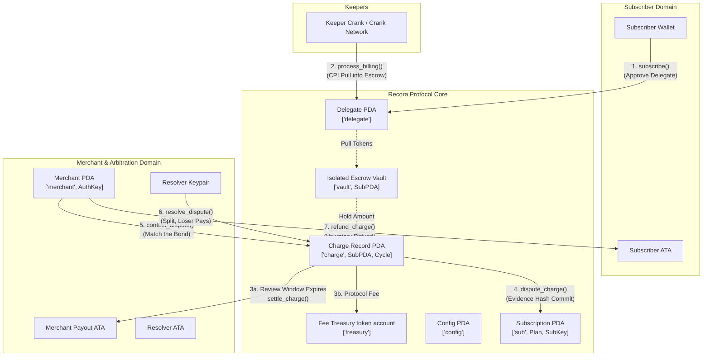
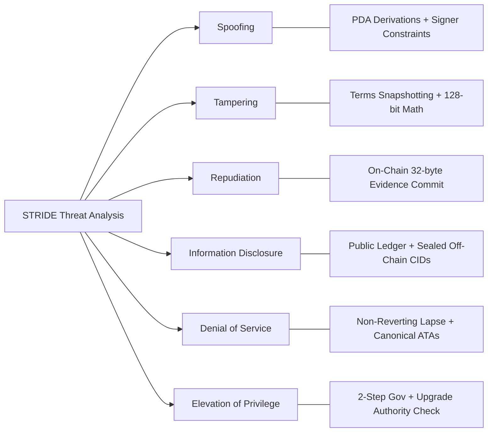
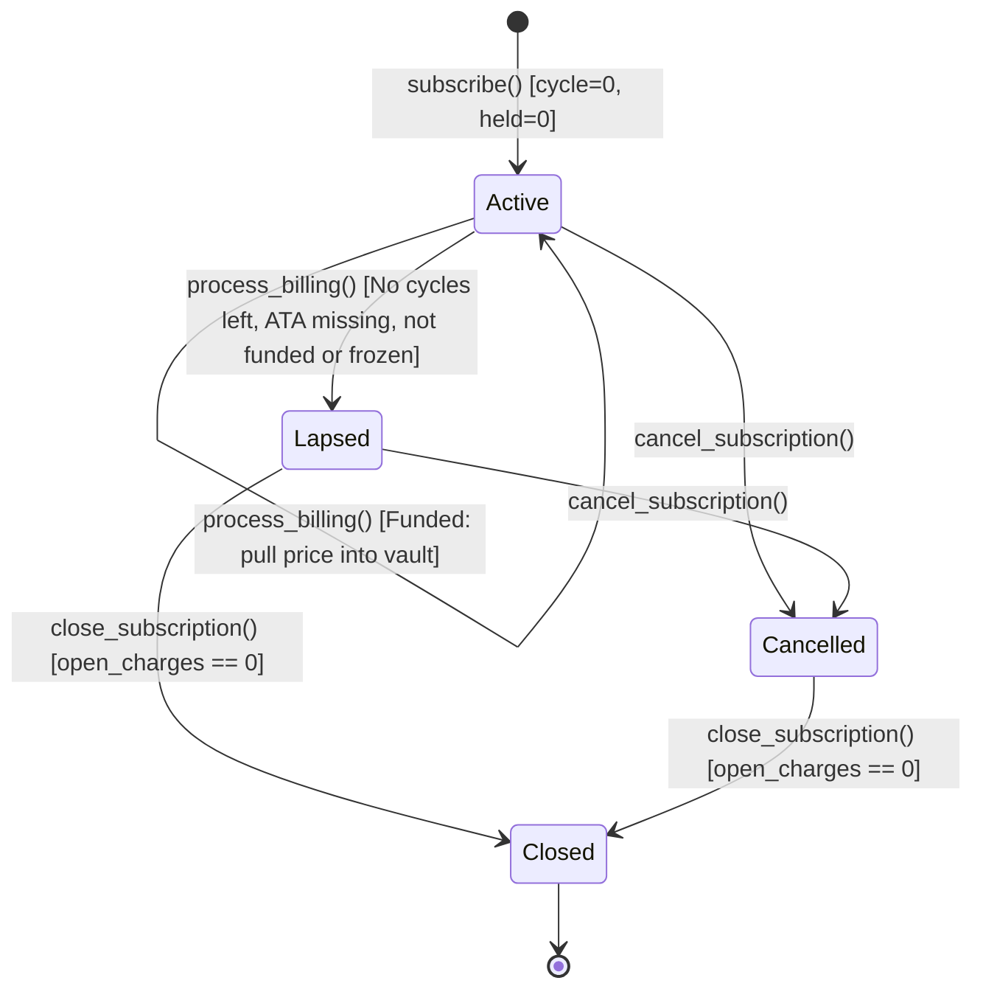
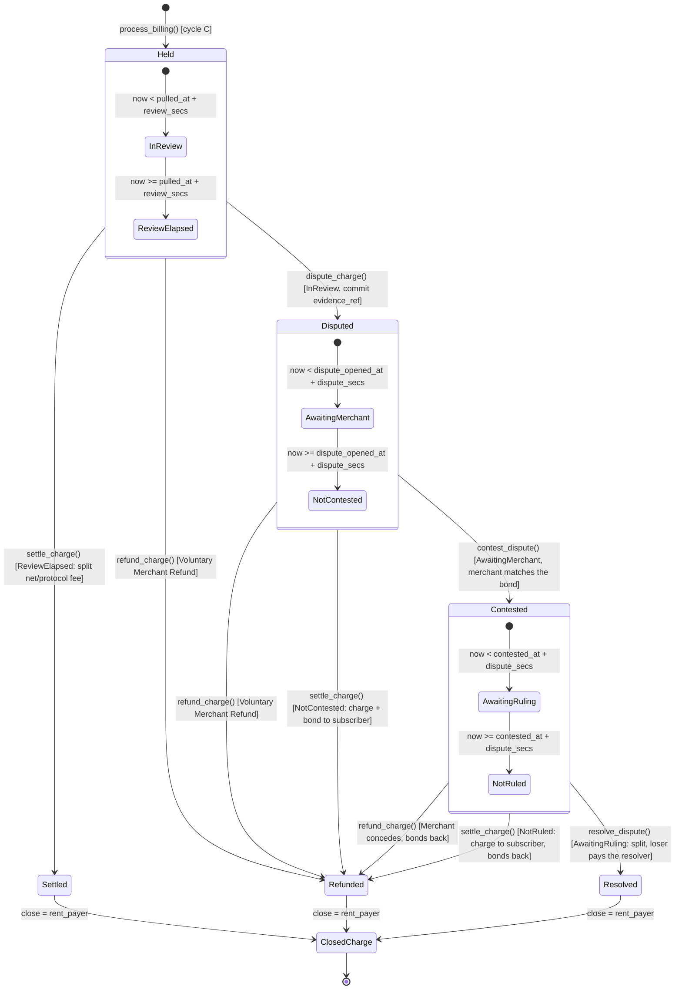

# Recora Protocol: Security Audit & Threat Model Report

**Audit Target:** Recora Smart Contract Suite (`programs/recora`)  
**Blockchain:** Solana (Anchor 1.2.0)  
**Version:** 0.1.0  
**Program ID:** `ByzDYmPuV1FK7Z4RMGLgnqELFLZf3u2GoRSsB9bTndiu`  
**Classification:** Non-Custodial Recurring Subscription & Pull Payment Protocol with On-Chain Escrow & Arbitration  
**Assessed:** 5 October 2026 · **Revised:** 8 October 2026 (four follow-up review rounds, see §6)

Links to source files are relative to this document. Line numbers are left out on purpose, because they go stale.

---

## 1. Executive Summary

### 1.1 Architecture & Protocol Overview
Recora is a non-custodial recurring payment and subscription protocol on Solana. Web3 recurring billing usually forces a trade-off: users either escrow large sums upfront in pooled custodial accounts, or they give merchants an unbounded token approval.

Recora combines **delegated token allowances**, **per-subscription isolated vault escrows**, **time-locked consumer review windows**, and an **on-chain dispute resolution framework**.



### 1.2 Core Architectural Principles
1. **Isolated vaults, no pooling:** Every subscription has its own token vault PDA (`['vault', sub.key()]`). There are no pooled reserves, so one vault can never be drained to pay another.
2. **Terms snapshotting:** The protocol fee and the dispute window are copied from the config into the `Plan` when the merchant creates it, so the merchant signs them. At subscribe time the price, interval, review window, dispute window, resolver, resolver fee, protocol fee and the number of approved cycles are copied into the `Subscription`. Later plan or config changes do not affect existing plans or subscriptions.
3. **One cycle per call, non-reverting lapse:** A keeper pulls exactly one cycle's price per call, once `now >= next_billing_ts`. `next_billing_ts` advances by one interval each time, so a keeper that was late can catch up missed cycles one call at a time (decision D6). Each subscription is billed at most `n_cycles` times. If the cycle cannot be funded (no cycles left, ATA missing, no delegate, low allowance, low balance or frozen), the subscription becomes `Lapsed` and the transaction succeeds.
4. **Bonded disputes, loser pays:** Pulled funds sit in review for `review_secs`. The subscriber disputes by committing a 32-byte evidence reference and posting a bond equal to the resolver fee. The merchant has `dispute_secs` to contest by matching the bond; if it does not, anyone can refund the subscriber in full, bond included. A contested dispute goes to the resolver, who must rule within `dispute_secs` of the contest; the resolver is paid one bond, and each side pays the part of it that matches the share it lost. If the resolver does not rule, the subscriber is refunded in full and both bonds go back.
5. **Keeper rent neutrality:** The keeper that bills a cycle pays the `Charge` rent, and every exit path (settle, refund, resolve, lapse) returns that rent to the recorded `charge.rent_payer`. Settlement loads only the token account it pays, so the keeper never has to recreate someone else's closed ATA.
6. **One classic SPL mint per deployment:** `Config.mint` is fixed at `initialize_config` and must be a classic SPL Token mint (e.g. USDC). Every merchant payout account and plan must use it. Token-2022 is not supported (§6.5, C-2 and C-6).

---

## 2. Requirement-by-Requirement Verification Matrix

| Requirement ID | Specification Summary | Source Implementation File | On-Chain Security Controls & Constraints | Verification Status |
| :--- | :--- | :--- | :--- | :--- |
| **REQ-01** | Initialization & upgrade authority validation | [`initialize_config.rs`](../programs/recora/src/instructions/initialize_config.rs) | `program == crate::ID`; ProgramData derived by seeds under the upgradeable loader with `upgrade_authority_address == Some(deployer)`; `fee_bps <= 100`; `max_resolver_fee_bps <= 1000`; `0 < min <= max <= MAX_WINDOW_SECS` for every window; the mint is typed as a classic SPL Token mint, so a Token-2022 mint fails before anything is created. | **VERIFIED** |
| **REQ-02** | Two-step governance transfer & admin fee caps | [`update_config.rs`](../programs/recora/src/instructions/update_config.rs) | `propose_authority` sets `pending_authority`; `accept_authority` requires `Signer == pending_authority`; `update_config_fee` enforces `fee_bps <= 100`; `update_config_windows` enforces the same window bounds as REQ-01; every branch emits `ConfigUpdated` with the full config. | **VERIFIED** |
| **REQ-03** | Treasury fee withdrawal | [`withdraw_fees.rs`](../programs/recora/src/instructions/withdraw_fees.rs) | `has_one = authority`; treasury pinned by `seeds = [SEED_TREASURY], bump = config.treasury_bump`; `amount <= treasury.amount`; CPI via `transfer_checked`. | **VERIFIED** |
| **REQ-04** | Merchant registration & payout ATA | [`initialize_merchant.rs`](../programs/recora/src/instructions/initialize_merchant.rs) | Merchant PDA `[SEED_MERCHANT, merchant_authority]`; payout account must be the canonical ATA of the merchant authority for `config.mint` under its token program, and its mint must equal `config.mint`. | **VERIFIED** |
| **REQ-05** | Plan creation, parameter windows & fee caps | [`create_plan.rs`](../programs/recora/src/instructions/create_plan.rs) | `!config.paused`; `price > 0`; `interval_secs` and `review_secs` within config bounds; `mint == config.mint`; `resolver != merchant.authority`; `resolver_fee_bps <= max_resolver_fee_bps`; copies `config.fee_bps` and `config.dispute_secs` into the plan. | **VERIFIED** |
| **REQ-06** | Subscription terms snapshotting | [`subscribe.rs`](../programs/recora/src/instructions/subscribe.rs) | `!config.paused`; `n_cycles > 0`; `mint == plan.mint`; subscriber is neither the merchant authority nor the resolver; plan terms re-checked against the current config bounds; subscriber ATA must be canonical; snapshots `price`, `interval_secs`, `review_secs`, `resolver`, `resolver_fee_bps` and the plan's `dispute_secs` and `fee_bps`; stores `merchant` and `cycles_remaining = n_cycles`. | **VERIFIED** |
| **REQ-07** | Zero-transfer cycle 0 & delegate approval | [`subscribe.rs`](../programs/recora/src/instructions/subscribe.rs) | No tokens move at subscribe; approves the shared `[SEED_DELEGATE]` PDA for `n_cycles * price`, added to the existing allowance when the ATA's delegate is already that PDA; `current_cycle = 0`. | **VERIFIED** |
| **REQ-08** | Keeper billing execution | [`process_billing.rs`](../programs/recora/src/instructions/process_billing.rs) | `sub.status == Active`; `now >= sub.next_billing_ts`; plan bound to the subscription by seeds; token program pinned to SPL Token; subscriber ATA pinned to the canonical address and read in the handler; funded means `cycles_remaining > 0`, the ATA exists, `delegate == Delegate PDA`, `delegated_amount >= price`, `amount >= price`, not frozen; CPI pull into the vault; `next_billing_ts += interval_secs`; `cycles_remaining -= 1`. | **VERIFIED** |
| **REQ-09** | Non-reverting lapse | [`process_billing.rs`](../programs/recora/src/instructions/process_billing.rs) | If not funded (including a missing ATA or no cycles left): `status = Lapsed`, `plan.subs_count -= 1`, the just-created charge account is closed back to the caller, `SubscriptionLapsed` is emitted and the call returns `Ok(())`. | **VERIFIED** |
| **REQ-10** | Dispute window, evidence hash & bond | [`dispute_charge.rs`](../programs/recora/src/instructions/dispute_charge.rs) | `charge.state == Held`; subscription bound to the signing subscriber by seeds; `now < pulled_at + review_secs`; stores `evidence_ref: [u8; 32]` and `dispute_opened_at`; moves a bond of `amount * resolver_fee_bps / 10_000` from the subscriber into the vault. | **VERIFIED** |
| **REQ-10b** | Merchant contests a dispute | [`contest_dispute.rs`](../programs/recora/src/instructions/contest_dispute.rs) | Signer is the merchant authority and `merchant == sub.merchant`; `charge.state == Disputed`; `now < dispute_opened_at + dispute_secs`; moves a bond equal to the subscriber's into the vault; `Contested`, `contested_at = now`. | **VERIFIED** |
| **REQ-11** | Settlement after the review window | [`settle_charge.rs`](../programs/recora/src/instructions/settle_charge.rs) | `Held` and `now >= pulled_at + review_secs`; `merchant == sub.merchant`; `merchant_ata == merchant.payout_ata`; `treasury == config.fee_treasury`; protocol fee to treasury (none while the treasury is frozen), net to merchant; the subscriber's ATA is not loaded; charge closed to `rent_payer`. | **VERIFIED** |
| **REQ-12** | Dispute timeout refund | [`settle_charge.rs`](../programs/recora/src/instructions/settle_charge.rs) | `Disputed` and `now >= dispute_opened_at + dispute_secs` (never contested), or `Contested` and `now >= contested_at + dispute_secs` (never ruled); charge and subscriber bond to the subscriber's canonical ATA; merchant bond back to the payout ATA if it can receive, otherwise left for the subscriber; emits `ChargeRefundedAfterTimeout`; charge closed to `rent_payer`. | **VERIFIED** |
| **REQ-13** | Merchant refund | [`refund_charge.rs`](../programs/recora/src/instructions/refund_charge.rs) | Signer is the merchant authority and `merchant == sub.merchant`; `Held`, `Disputed` or `Contested`; charge and subscriber bond to the subscriber's canonical ATA, merchant bond back; charge closed to `rent_payer`. | **VERIFIED** |
| **REQ-14** | Resolver ruling split | [`resolve_dispute.rs`](../programs/recora/src/instructions/resolve_dispute.rs) | `charge.state == Contested`; `sub.resolver == resolver`; `now < contested_at + dispute_secs`; `merchant_bps <= 10_000`; `merchant == sub.merchant`; `split_ruling`: the charge split by `merchant_bps`, the resolver paid one bond to its canonical ATA, each side paying the part of it that matches its loss; 128-bit maths; the only rounding is the merchant's gross share, whose dust goes to the subscriber. | **VERIFIED** |
| **REQ-15** | Cancel subscription | [`cancel_subscription.rs`](../programs/recora/src/instructions/cancel_subscription.rs) | Subscription bound to the signing subscriber by seeds; `plan == sub.plan`; `Active` or `Lapsed` → `Cancelled`; `subs_count` decremented only from `Active`. The delegate is not revoked on-chain (D7). | **VERIFIED** |
| **REQ-16** | Close subscription & vault | [`close_subscription.rs`](../programs/recora/src/instructions/close_subscription.rs) | `status ∈ {Cancelled, Lapsed}`; `open_charges == 0`; leftover vault tokens swept to the subscriber; vault and subscription closed to the subscriber. | **VERIFIED** |

---

## 3. STRIDE Threat Model Analysis



### 3.1 Spoofing
- **Threat Vector 1: Impersonating the upgrade authority during config initialization.**  
  *Mitigation:* [`initialize_config.rs`](../programs/recora/src/instructions/initialize_config.rs) requires `program == crate::ID` and derives `program_data` from this program's ID under the upgradeable loader, then checks `upgrade_authority_address == Some(deployer)`. A ProgramData account of some other program is rejected.
- **Threat Vector 2: Impersonating the merchant to receive settled funds.**  
  *Mitigation:* Each subscription stores its `merchant`. [`settle_charge.rs`](../programs/recora/src/instructions/settle_charge.rs), [`refund_charge.rs`](../programs/recora/src/instructions/refund_charge.rs) and [`resolve_dispute.rs`](../programs/recora/src/instructions/resolve_dispute.rs) require `merchant.key() == sub.merchant`, and payouts go to `merchant.payout_ata`. Before this binding existed, any merchant account could be passed in (finding A-1).
- **Threat Vector 3: A rogue actor resolving disputes.**  
  *Mitigation:* [`resolve_dispute.rs`](../programs/recora/src/instructions/resolve_dispute.rs) requires `sub.resolver == resolver` with `resolver: Signer`, and the resolver fee goes only to the canonical ATA of `sub.resolver`.

### 3.2 Tampering
- **Threat Vector 1: Merchant changing price or interval after subscribe.**  
  *Mitigation:* [`subscribe.rs`](../programs/recora/src/instructions/subscribe.rs) snapshots every billing parameter into the `Subscription`. Later plan or config changes do not affect existing subscriptions.
- **Threat Vector 2: Manipulating fee basis points.**  
  *Mitigation:* The protocol fee is capped at 100 bps (1%) on creation and update. Resolver fees are capped by `max_resolver_fee_bps`, itself at most 1000 bps (10%).
- **Threat Vector 3: Token-2022 behaviour changing amounts or blocking payouts.**  
  *Mitigation:* Only classic SPL Token mints are accepted. An allowlist of Token-2022 mint extensions (the earlier fix for B-3) was not enough: an account owner can turn on required memos on their own token account and veto payouts (C-2), and a mint with a close authority can be closed and re-created at the same address with other extensions (C-6). Classic mints cannot be closed, and classic token accounts have no such extensions.
- **Threat Vector 4: The admin changing the fee or dispute window under existing merchants.**  
  *Mitigation:* Both are copied into the plan when the merchant creates it (C-8); config changes apply only to plans created afterwards.

### 3.3 Repudiation
- **Threat Vector 1: A party denying that a dispute was raised.**  
  *Mitigation:* [`dispute_charge.rs`](../programs/recora/src/instructions/dispute_charge.rs) commits a 32-byte `evidence_ref`, records `dispute_opened_at`, and emits `ChargeDisputed`.
- **Threat Vector 2: A keeper denying a pull.**  
  *Mitigation:* `process_billing` emits `ChargePulled { charge, subscription, cycle, amount }` and stores `pulled_at` on the `Charge`. Every charge event carries the subscription, and rulings carry every amount, so an indexer does not need to read closed accounts.
- **Threat Vector 3: Telling "merchant conceded" apart from "dispute abandoned".**  
  *Mitigation:* A merchant refund emits `ChargeRefunded`; a dispute timeout emits `ChargeRefundedAfterTimeout`.

### 3.4 Information Disclosure
- **Threat Vector 1: Leaking dispute materials or PII.**  
  *Mitigation:* Only the 32-byte `evidence_ref` is stored on-chain. Off-chain material (receipts, chat logs, IPFS CIDs) stays with the parties until disclosed.

### 3.5 Denial of Service (DoS)
- **Threat Vector 1: Delinquent subscribers making keeper transactions revert.**  
  *Mitigation:* An unfunded subscription lapses and the call succeeds (REQ-09), including when the subscriber's ATA was closed (C-7). The token program is pinned, so nobody can lapse a funded subscription by passing another token program. A keeper can still waste a fee on a call that is not due yet or on an inactive subscription; the bundled keeper checks these before sending.
- **Threat Vector 2: Subscriber draining the vault while charges are open.**  
  *Mitigation:* [`close_subscription.rs`](../programs/recora/src/instructions/close_subscription.rs) requires `open_charges == 0`.
- **Threat Vector 3: A merchant or resolver freezing escrowed funds forever.**  
  *Mitigation:* An uncontested dispute is refunded in full `dispute_secs` after it opens; a contested one `dispute_secs` after the contest. From then on the merchant can no longer contest and the resolver can no longer rule.
- **Threat Vector 4: A party blocking payouts through its token account.**  
  *Mitigation:* Every payout destination is a canonical ATA, so anyone can recreate one that was closed. Settle and resolve take the payout accounts unchecked and pinned by address, so only the account that receives something is loaded; closing the other party's account blocks nothing (C-4). If a merchant closes or freezes its payout account during a dispute, its bond is left for the subscriber instead of blocking the refund. The subscriber ATA is checked by address only, not by owner: on classic SPL Token the subscriber can change the ATA's owner, and an owner check let them block the resolver and merchant (B-1).
- **Threat Vector 5: Corrupting a plan's subscriber count.**  
  *Mitigation:* `cancel_subscription` requires `plan == sub.plan`, so a cancel can only decrement the subscription's own plan (finding B-2).
- **Threat Vector 6: A frozen fee treasury halting settlements.**  
  *Mitigation:* While the treasury is frozen the protocol fee is skipped, so settlements and rulings for every merchant keep working (C-9).
- **Threat Vector 7: Frivolous disputes.**  
  *Mitigation:* A dispute costs the subscriber a bond equal to the resolver fee, which it loses in proportion to how far the ruling goes against it (C-3).

### 3.6 Elevation of Privilege
- **Threat Vector 1: Immediate authority takeover via single-step transfer.**  
  *Mitigation:* Two-step governance (REQ-02): `propose_authority(new_auth)` then `accept_authority()` signed by the new authority.
- **Threat Vector 2: Unauthorized fee withdrawal.**  
  *Mitigation:* [`withdraw_fees.rs`](../programs/recora/src/instructions/withdraw_fees.rs) uses `has_one = authority`.

---

## 4. Economic & Invariant Analysis

### 4.1 Escrow Isolation Per Subscription
$$\forall \text{ sub}_i, \quad \text{Vault}_i = \text{PDA}(\text{"vault"}, \text{sub}_i), \quad \text{Authority}(\text{Vault}_i) = \text{sub}_i$$

The vault signs transfers with the subscription's seeds `[SEED_SUB, plan, subscriber, &[bump]]`, so tokens in $\text{Vault}_i$ can never pay obligations of $\text{Vault}_j$.

`held_total` counts every open charge's amount plus the bonds posted on it. Every exit releases exactly the charge plus its bonds and lowers `held_total` by the same sum; a bond that cannot be returned to a closed or frozen merchant account stays in the vault and is swept to the subscriber at close. So $`\text{vault.amount} \ge \text{held\_total}`$ always holds. This relies on the vault receiving the full amount on every transfer, which classic SPL Token guarantees.

### 4.2 Keeper Rent Neutrality
When a keeper calls `process_billing` it pays rent for the new `Charge` and is recorded as `charge.rent_payer`. Every exit returns that rent:
- Settled or timeout-refunded via [`settle_charge.rs`](../programs/recora/src/instructions/settle_charge.rs) (`close = rent_payer`)
- Refunded via [`refund_charge.rs`](../programs/recora/src/instructions/refund_charge.rs) (`close = rent_payer`)
- Resolved via [`resolve_dispute.rs`](../programs/recora/src/instructions/resolve_dispute.rs) (`close = rent_payer`)
- Lapsed in `process_billing` (the charge is closed back to the caller in the same call)

Settlement does not need the token account of a party it does not pay, and the bundled keeper no longer recreates closed ATAs (it can, with `KEEPER_CREATE_ATAS=1`, at its own cost). Before this a merchant or subscriber could close an ATA, let the keeper recreate it for about 0.002 SOL, and close it again to keep the rent (C-4).

$$\text{Net Rent Cost for Keeper} = 0 \text{ SOL (transaction fees only)}$$

### 4.3 Checked Arithmetic
Fee splits use `u128` intermediates. Every `checked_*` operation returns `MathOverflow` instead of panicking; `merchant.total_revenue` is a statistic and saturates, so it can never block a payout. Time windows are converted with `i64::try_from` and are capped at `MAX_WINDOW_SECS` (ten years), so timestamp maths cannot wrap.

### 4.4 Rulings, Bonds and Rounding
`split_ruling` in [`resolve_dispute.rs`](../programs/recora/src/instructions/resolve_dispute.rs) computes a ruling from the charge `amount`, the two bonds (each equal to $`B = \lfloor \text{amount} \times \text{resolver\_bps} / 10{,}000 \rfloor`$) and `merchant_bps`:

1. `merchant_gross` = $`\lfloor \text{amount} \times \text{merchant\_bps} / 10{,}000 \rfloor`$; $`\text{subscriber\_share} = \text{amount} - \text{merchant\_gross}`$.
2. `protocol_fee` = $`\lfloor \text{merchant\_gross} \times \text{fee\_bps} / 10{,}000 \rfloor`$ (0 while the treasury is frozen); $`\text{merchant\_net} = \text{merchant\_gross} - \text{protocol\_fee}`$.
3. The subscriber pays $`\lfloor B \times \text{merchant\_bps} / 10{,}000 \rfloor`$ of the resolver fee out of its bond and the merchant pays the rest out of its own; the resolver receives exactly $B$, and each side gets the unused part of its bond back.

**Conservation:**
```math
\text{resolver\_fee} + \text{protocol\_fee} + \text{merchant\_net} + \text{subscriber\_share} + \text{bonds returned} \equiv \text{amount} + 2B
```

The only rounding on the charge is the floor of `merchant_gross`, so its dust goes to the subscriber; the protocol-fee floor stays with the merchant. No dust stays in the vault. `rulings_move_exactly_the_charge_and_both_bonds` checks every balance for six splits, and `split_ruling_conserves_value` checks the identity over a grid of amounts, bonds and splits.

---

## 5. Access Control Table

| Instruction | Required Signers | Mutable Accounts (`mut`) | State Validations & Constraints | Closed Accounts & Rent Recipient |
| :--- | :--- | :--- | :--- | :--- |
| `initialize_config` | `deployer` | `config`, `treasury`, `deployer` | upgrade authority via canonical ProgramData; fee and window bounds; classic SPL mint | None |
| `update_config_fee` | `authority` | `config` | `config.authority == authority`; `fee_bps <= 100` | None |
| `update_config_paused` | `authority` | `config` | `config.authority == authority` | None |
| `propose_authority` | `authority` | `config` | `config.authority == authority` | None |
| `accept_authority` | `pending_authority` | `config` | `config.pending_authority == pending_authority` | None |
| `update_config_windows`| `authority` | `config` | `config.authority == authority`; `0 < min <= max <= MAX_WINDOW_SECS` | None |
| `withdraw_fees` | `authority` | `treasury`, `destination` | `config.authority == authority`; `amount <= treasury.amount` | None |
| `initialize_merchant` | `merchant_authority` | `merchant`, `merchant_authority` | canonical payout ATA for `config.mint` | None |
| `create_plan` | `merchant_authority` | `plan`, `merchant`, `merchant_authority` | `merchant.authority == merchant_authority`; `!config.paused`; `mint == config.mint`; fee and dispute window copied from config | None |
| `subscribe` | `subscriber` | `sub`, `vault`, `plan`, `subscriber_ata`, `subscriber` | `!config.paused`; `n_cycles > 0`; no party conflict; canonical subscriber ATA; bounds re-check | None |
| `process_billing` | `caller` (keeper) | `sub`, `plan`, `charge`, `vault`, `subscriber_ata`, `caller` | `now >= next_billing_ts`; `status == Active`; canonical subscriber ATA (may be missing); SPL Token program | `charge` closed to `caller` on lapse |
| `dispute_charge` | `subscriber` | `charge`, `sub`, `vault`, `bond_source`, `subscriber` | `sub.subscriber == subscriber`; `charge.state == Held`; `now < pulled_at + review_secs`; bond paid | None |
| `contest_dispute` | `merchant_authority` | `charge`, `sub`, `vault`, `bond_source`, `merchant_authority` | `merchant == sub.merchant`; `charge.state == Disputed`; `now < dispute_opened_at + dispute_secs`; bond matched | None |
| `settle_charge` | `caller` (anyone) | `charge`, `sub`, `vault`, `merchant`, `merchant_ata`, `subscriber_ata`, `treasury`, `rent_payer`, `caller` | `merchant == sub.merchant`; `charge.state ∈ {Held, Disputed, Contested}`; window checks; only the paid accounts are loaded | `charge` closed to `rent_payer` |
| `refund_charge` | `merchant_authority` | `charge`, `sub`, `vault`, `subscriber_ata`, `merchant_ata`, `rent_payer` | `merchant == sub.merchant`; `charge.state ∈ {Held, Disputed, Contested}` | `charge` closed to `rent_payer` |
| `resolve_dispute` | `resolver` | `charge`, `sub`, `vault`, `subscriber_ata`, `merchant`, `merchant_ata`, `treasury`, `resolver_ata`, `rent_payer` | `sub.resolver == resolver`; `charge.state == Contested`; `now < contested_at + dispute_secs`; `merchant_bps <= 10_000` | `charge` closed to `rent_payer` |
| `cancel_subscription` | `subscriber` | `sub`, `plan`, `subscriber` | `sub.subscriber == subscriber`; `plan == sub.plan`; `status ∈ {Active, Lapsed}` | None |
| `close_subscription` | `subscriber` | `sub`, `vault`, `subscriber_ata`, `subscriber` | `sub.subscriber == subscriber`; `status ∈ {Cancelled, Lapsed}`; `open_charges == 0` | `sub` and `vault` closed to `subscriber` |

---

## 6. Findings and Their Status

All findings below are fixed. Each fix has a regression test in `programs/recora/tests/` (the third round's in `test_third_pass.rs`) that asserts the exact error code or balances, except where the table says otherwise; the keeper is covered by `tests/keeper.smoke.ts`, which CI runs on a local validator.

### 6.1 Initial assessment (5 October 2026)

| ID | Severity | Finding | Status |
| :--- | :--- | :--- | :--- |
| REC-01 | Medium | A lapse in `process_billing` left the just-created `Charge` account allocated, locking the keeper's rent and making a retry for the same cycle fail. | **Fixed.** The charge is closed back to the caller on lapse. |
| REC-02 | Low | `resolver_ata` in `resolve_dispute` had no owner or address check. | **Fixed.** It must be the canonical ATA of `sub.resolver`. |
| REC-03 | Info | `program_data` was not tied to this program's ID. | **Fixed.** Derived by seeds under the upgradeable loader, and `program == crate::ID`. |

### 6.2 Review round A: account binding

| ID | Severity | Finding | Status |
| :--- | :--- | :--- | :--- |
| A-1 | High | `settle_charge` and `resolve_dispute` did not bind the merchant to the subscription. An attacker could pass their own merchant account and receive another merchant's settlement (PoC moved 14,925,000 base units). | **Fixed.** `Subscription.merchant` is stored at subscribe; `merchant.key() == sub.merchant` is required. |
| A-2 | High | `refund_charge` accepted any merchant authority, so a subscriber acting as a merchant could refund their own charges. | **Fixed** by the same binding. |
| A-3 | Medium | `subscribe` did not check `mint == plan.mint`; a vault with the wrong mint left the subscription `Active` but never billable. | **Fixed.** Mint checked; `Config.mint` added and plans and payout accounts must use it. |
| A-4 | Low | Party-conflict check compared against the merchant PDA instead of the merchant authority. | **Fixed.** |

### 6.3 Review round B: architecture gaps

| ID | Severity | Finding | Status |
| :--- | :--- | :--- | :--- |
| G-1 | Medium | Token accounts were not required to be canonical ATAs, so a closed payout account could not be recreated by anyone else. | **Fixed.** Canonical ATA checks on every payout and subscriber account. |
| G-2 | Low | A lapse did not decrement `plan.subs_count`. | **Fixed.** |
| G-3 | Low | `subscribe` did not re-check plan terms against config bounds tightened after the plan was created. | **Fixed.** `InvalidTerms`. |

### 6.4 Review round C: second full audit (7 October 2026)

| ID | Severity | Finding | Status |
| :--- | :--- | :--- | :--- |
| B-1 | High | On classic SPL Token the subscriber can change the owner of their ATA. Settle, refund and resolve required `subscriber_ata.owner == sub.subscriber`, so after an owner swap the resolver and merchant were locked out; the subscriber swapped back after the dispute timeout and received a full refund. The same swap froze settlement of undisputed charges. | **Fixed.** Only the canonical address is checked. An owner change clears the delegate, so billing lapses the subscription instead of reverting. |
| B-2 | Medium | `cancel_subscription` did not require `plan == sub.plan`. Anyone could drive another plan's `subs_count` to 0, after which that plan's honest subscribers could not cancel, lapse or close. | **Fixed.** |
| B-3 | Medium | A Token-2022 mint with a transfer fee made the vault receive less than `charge.amount`, so the charge could never settle or refund. Permanent delegate, transfer hook, default-frozen and pausable mints carry similar risks. | **Fixed**, first with an extension allowlist, now by accepting only classic SPL mints (C-2, C-6). |
| B-4 | Low | Window values were cast `u64 as i64`. With a max bound ≥ 2^63 a review window became negative (no dispute possible, instant settle) and billing could repeat at one timestamp. | **Fixed.** All windows capped at `MAX_WINDOW_SECS`; conversions use `i64::try_from`. |
| B-5 | Low | A frozen subscriber ATA made billing revert instead of lapsing (the architecture lists "frozen" as a lapse cause). | **Fixed.** |
| B-6 | Low | The dispute timeout emitted the same event as a merchant refund, and three config branches emitted no event. | **Fixed.** `ChargeRefundedAfterTimeout`; `ConfigUpdated` on every branch with the full config. |
| B-7 | Info | The resolver could still rule after the dispute timeout and race the timeout refund. | **Fixed by decision.** The resolver must rule before `dispute_opened_at + dispute_secs` (`DisputeTimedOut`). |
| B-8 | Info | `subscribe(n_cycles = 0)` was accepted and could silently replace another app's approval with 0. | **Fixed.** `n_cycles > 0` (`InvalidTerms`). |
| B-9 | Info | Several handlers used `unwrap()` on checked maths, which panics instead of returning an error. | **Fixed.** `MathOverflow` (asserted in `exact_error_codes`). |

The same round fixed the off-chain keeper (`scripts/keeper.ts`): it passed incomplete account lists and wrong field names, so it could neither bill nor settle.

### 6.5 Review round D: third full audit (8 October 2026)

Three parallel reviews: on-chain security (with proof-of-concept tests), the design documents against the code, and the keeper, tests, CI and documentation.

| ID | Severity | Finding | Status |
| :--- | :--- | :--- | :--- |
| C-1 | High | `anchor build` (Anchor 1.2 defaults to SBPFv3) produced a program that the pinned validator, LiteSVM and `solana program deploy` could not load: 0/38 Rust tests and 0/9 TypeScript tests passed on it. The README and `pnpm build` used that command; CI built with `cargo-build-sbf` and stayed green. | **Fixed.** `pnpm build` is `anchor build --arch v0`; CI builds with it and checks the ELF machine type. |
| C-2 | Medium | On Token-2022 a subscriber could enable required memos on its own ATA. Recora's transfers carry no memo, so every ruling that paid the subscriber anything, and every merchant refund, failed; after the dispute timeout the subscriber disabled it and took 100%. A merchant could do the same to its payout ATA and block settlement and `close_subscription`. Same outcome as B-1, through another route. | **Fixed.** Only classic SPL Token mints are accepted. |
| C-3 | Medium | The resolver fee came off the top of every ruling, so the side that won paid it, a frivolous dispute cost the subscriber nothing, and a valid one cost it the fee while doing nothing refunded it in full. | **Fixed.** Bonded disputes: the subscriber posts the resolver fee as a bond, the merchant must match it to contest, and the resolver is paid from the bonds in proportion to each side's loss (§4.4). |
| C-4 | Medium | `settle_charge` and `resolve_dispute` required the token accounts of parties they did not pay, and the keeper recreated missing ATAs before every settle. A merchant or subscriber could close an ATA, let the keeper pay its rent, close it again and keep the rent, every cycle; the documented "keeper rent = 0" did not hold. | **Fixed.** Payout accounts are unchecked and pinned by address, and only the paid ones are loaded; the keeper no longer recreates ATAs unless `KEEPER_CREATE_ATAS=1`. |
| C-5 | Medium | CI ran only the Rust tests: not the TypeScript tests, the keeper, the typecheck or a client drift check, so a repeat of the keeper bug from round C would have passed. | **Fixed.** CI builds, runs the Rust tests, checks the generated client, typechecks, and runs the TypeScript tests and a keeper smoke test on a local validator. |
| C-6 | Low | `MintCloseAuthority` was on the Token-2022 allowlist and extensions were checked only at `initialize_config`, so a mint could be closed at zero supply and re-created at the same address with a permanent delegate or a transfer fee, bypassing B-3. | **Fixed.** Classic SPL mints cannot be closed. |
| C-7 | Low | A closed subscriber ATA made `process_billing` revert instead of lapsing, so the subscription stayed `Active`, counted in `subs_count`, and could back-bill every missed cycle once the ATA reappeared. | **Fixed.** It lapses. |
| C-8 | Low | The merchant never signed the protocol fee or dispute window; both were read from the config at subscribe time, so the admin could change them for new subscribers to existing plans (a 1-second dispute window made every dispute time out). | **Fixed.** Copied into the plan at `create_plan`. |
| C-9 | Low | A frozen fee treasury made every settlement and every ruling with a protocol fee revert, for all merchants. | **Fixed.** The fee is skipped while the treasury is frozen. |
| C-10 | Low | Keeper errors from transactions that passed preflight read "Unknown action 'undefined'", with no error code or logs (Anchor 0.32's provider on web3.js 1.98+). | **Fixed.** The keeper sends with web3.js and prints the program logs. |
| C-11 | Low | Documentation errors: `anchor test` needs surfpool, which was not listed; the README claimed all rounding dust goes to the subscriber; this report claimed a regression test for every fix. | **Fixed.** Commands, claims and tests corrected. |
| C-12 | Info | `n_cycles` only sized the shared delegate allowance; a subscription approved for one cycle could keep billing out of the allowance approved for another (12 pulls in the PoC). | **Fixed.** `cycles_remaining` per subscription; the subscription lapses when it reaches 0. |
| C-13 | Info | Events lacked the subscription, merchant and amounts an indexer needs, and charges are closed at every terminal state. | **Fixed.** Events carry keys and amounts. |
| C-14 | Info | `merchant.total_revenue` used `checked_add`; an overflow would have blocked that merchant's settlements. | **Fixed.** Saturating. |

Earlier fixes were re-checked and hold for the cases they targeted; B-1 and B-3 had the new routes above. Error codes that earlier tests only checked as "some error" are now asserted exactly (`FeeTooHigh`, `ProtocolPaused`, `InvalidResolver`, `PartyConflict`, `SubscriptionNotActive`, `InvalidState`, `InvalidSplit`, `MathOverflow`).

---

## 7. Lifecycle State Machine Diagrams

### 7.1 Subscription State Transitions



### 7.2 Charge Lifecycle & Escrow Resolution



---

## 8. Conclusion

All findings from the initial assessment and the four review rounds are fixed and covered by regression tests. The program provides:
- **Isolated escrow:** one vault per subscription, and every payout bound to stored keys.
- **Snapshotted terms:** no retroactive changes by merchants or governance.
- **Conserved amounts:** checked 128-bit maths, subscriber-first dust on the charge, keeper rent neutrality.
- **Dispute protection:** a bounded review window, bonded disputes where the loser pays the resolver, and an automatic full refund when the merchant does not contest or the resolver does not rule.

**Known limitations, by design:**
- One delegate per token account: the allowance on a subscriber's ATA is shared by all of its Recora subscriptions (each is capped at its own `n_cycles`), and approving any other delegate on that ATA replaces it, so every subscription lapses at its next billing.
- A late keeper bills missed cycles back to back, one per call (D6); every charge still gets its own review window.
- One classic SPL mint per deployment; Token-2022 is not supported.
- The delegate is not revoked on cancel (D7); subscribers revoke it in their wallet.
- The first charge is pulled by the keeper after `subscribe`, not in the same transaction; a merchant should grant access on `ChargePulled` for cycle 0, or bundle `process_billing` into the checkout transaction.
- A lapse is final (no grace period): the subscriber closes the subscription once its charges are done and subscribes again.
- There is no instruction to rotate a merchant's authority or payout account, or a plan's resolver.
- A Circle freeze of a subscriber's or merchant's account blocks the payouts to that account.
