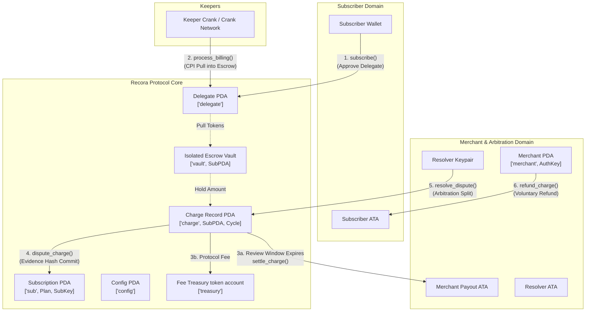
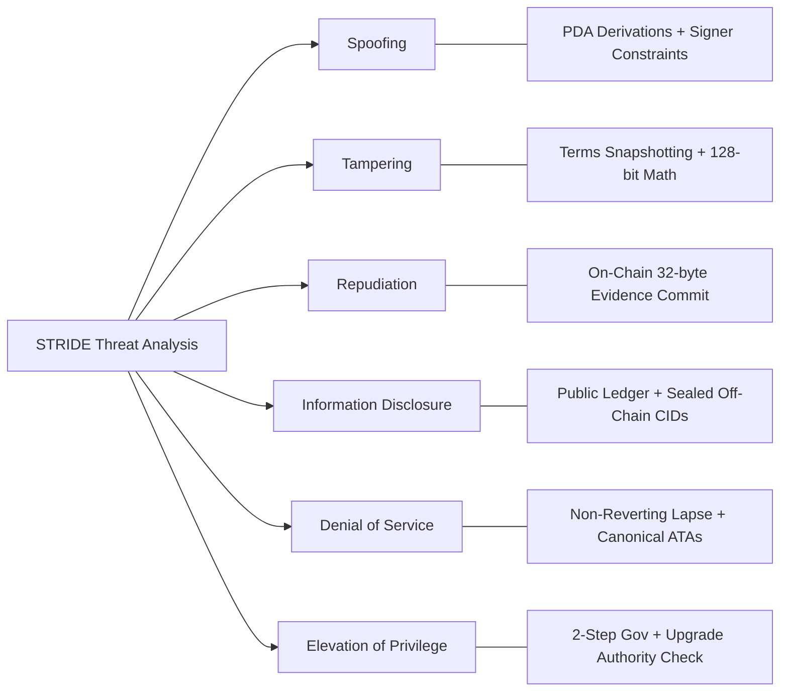
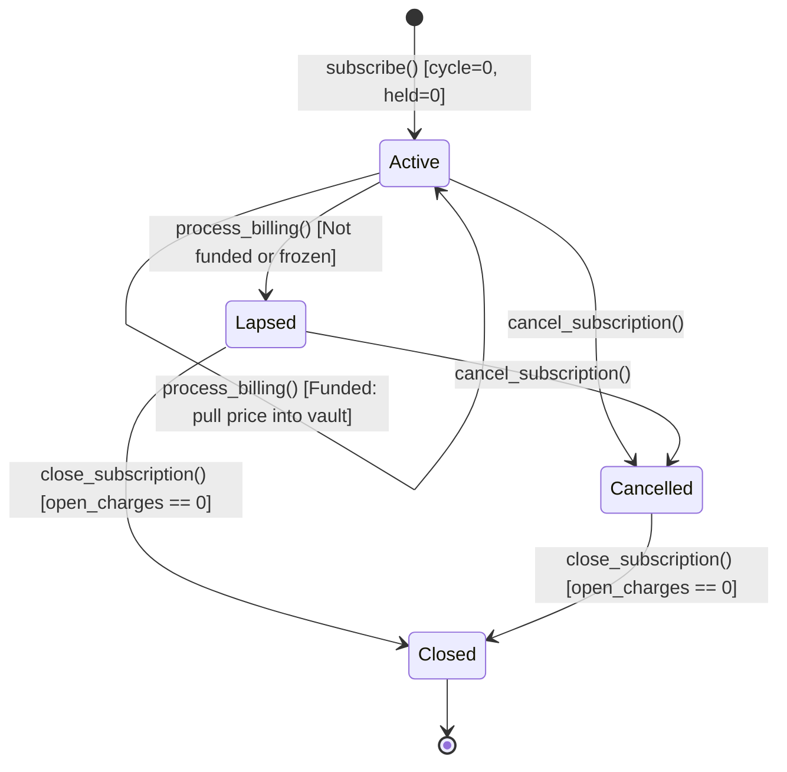
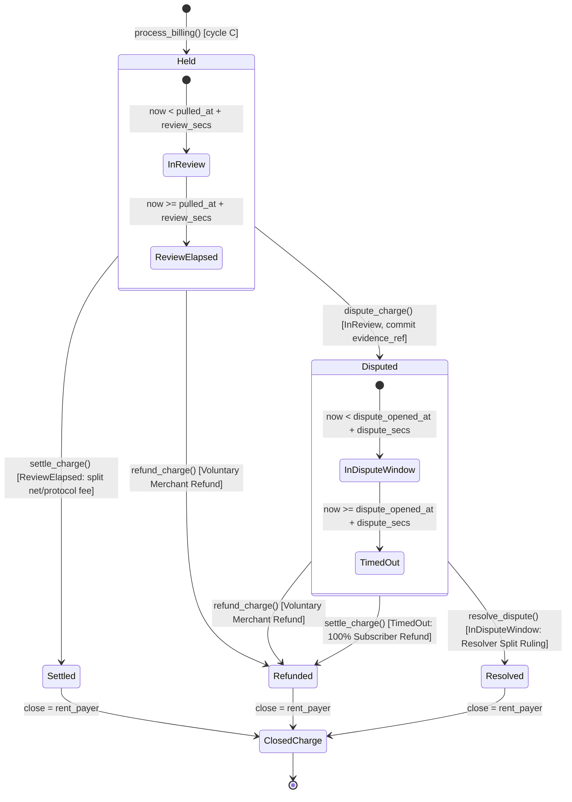

# Recora Protocol: Security Audit & Threat Model Report

**Audit Target:** Recora Smart Contract Suite (`programs/recora`)  
**Blockchain:** Solana (Anchor 1.2.0)  
**Version:** 0.1.0  
**Program ID:** `ByzDYmPuV1FK7Z4RMGLgnqELFLZf3u2GoRSsB9bTndiu`  
**Classification:** Non-Custodial Recurring Subscription & Pull Payment Protocol with On-Chain Escrow & Arbitration  
**Assessed:** 5 October 2026 · **Revised:** 7 October 2026 (three follow-up review rounds, see §6)

Links to source files are relative to this document. Line numbers are left out on purpose, because they go stale.

---

## 1. Executive Summary

### 1.1 Architecture & Protocol Overview
Recora is a non-custodial recurring payment and subscription protocol on Solana. Web3 recurring billing usually forces a trade-off: users either escrow large sums upfront in pooled custodial accounts, or they give merchants an unbounded token approval.

Recora combines **delegated token allowances**, **per-subscription isolated vault escrows**, **time-locked consumer review windows**, and an **on-chain dispute resolution framework**.



### 1.2 Core Architectural Principles
1. **Isolated vaults, no pooling:** Every subscription has its own token vault PDA (`['vault', sub.key()]`). There are no pooled reserves, so one vault can never be drained to pay another.
2. **Terms snapshotting:** At subscribe time the price, interval, review window, dispute window, resolver, resolver fee and protocol fee are copied into the `Subscription` account. Later plan or config changes do not affect existing subscriptions.
3. **One cycle per call, non-reverting lapse:** A keeper pulls exactly one cycle's price per call, once `now >= next_billing_ts`. `next_billing_ts` advances by one interval each time, so a keeper that was late can catch up missed cycles one call at a time (decision D6). If the subscriber's ATA cannot fund the cycle (no delegate, low allowance, low balance or frozen), the subscription becomes `Lapsed` and the transaction succeeds.
4. **Subscriber-centric dispute protection:** Pulled funds sit in review for `review_secs`. The subscriber can dispute by committing a 32-byte evidence reference. The resolver must rule within `dispute_secs`; after that the dispute counts as abandoned and anyone can trigger a 100% refund to the subscriber.
5. **Keeper rent neutrality:** The keeper that bills a cycle pays the `Charge` rent, and every exit path (settle, refund, resolve, lapse) returns that rent to the recorded `charge.rent_payer`.
6. **One mint per deployment:** `Config.mint` is fixed at `initialize_config`. Every merchant payout account and plan must use it. Both SPL Token and Token-2022 are supported, but Token-2022 mints with extensions that move or block funds are rejected (§6, B-3).

---

## 2. Requirement-by-Requirement Verification Matrix

| Requirement ID | Specification Summary | Source Implementation File | On-Chain Security Controls & Constraints | Verification Status |
| :--- | :--- | :--- | :--- | :--- |
| **REQ-01** | Initialization & upgrade authority validation | [`initialize_config.rs`](../programs/recora/src/instructions/initialize_config.rs) | `program == crate::ID`; ProgramData derived by seeds under the upgradeable loader with `upgrade_authority_address == Some(deployer)`; `fee_bps <= 100`; `max_resolver_fee_bps <= 1000`; `0 < min <= max <= MAX_WINDOW_SECS` for every window; Token-2022 mint extensions checked against an allowlist. | **VERIFIED** |
| **REQ-02** | Two-step governance transfer & admin fee caps | [`update_config.rs`](../programs/recora/src/instructions/update_config.rs) | `propose_authority` sets `pending_authority`; `accept_authority` requires `Signer == pending_authority`; `update_config_fee` enforces `fee_bps <= 100`; `update_config_windows` enforces the same window bounds as REQ-01; every branch emits `ConfigUpdated` with the full config. | **VERIFIED** |
| **REQ-03** | Treasury fee withdrawal | [`withdraw_fees.rs`](../programs/recora/src/instructions/withdraw_fees.rs) | `has_one = authority`; treasury pinned by `seeds = [SEED_TREASURY], bump = config.treasury_bump`; `amount <= treasury.amount`; CPI via `transfer_checked`. | **VERIFIED** |
| **REQ-04** | Merchant registration & payout ATA | [`initialize_merchant.rs`](../programs/recora/src/instructions/initialize_merchant.rs) | Merchant PDA `[SEED_MERCHANT, merchant_authority]`; payout account must be the canonical ATA of the merchant authority for `config.mint` under its token program, and its mint must equal `config.mint`. | **VERIFIED** |
| **REQ-05** | Plan creation, parameter windows & fee caps | [`create_plan.rs`](../programs/recora/src/instructions/create_plan.rs) | `!config.paused`; `price > 0`; `interval_secs` and `review_secs` within config bounds; `mint == config.mint`; `resolver != merchant.authority`; `resolver_fee_bps <= max_resolver_fee_bps`. | **VERIFIED** |
| **REQ-06** | Subscription terms snapshotting | [`subscribe.rs`](../programs/recora/src/instructions/subscribe.rs) | `!config.paused`; `n_cycles > 0`; `mint == plan.mint`; subscriber is neither the merchant authority nor the resolver; plan terms re-checked against the current config bounds; subscriber ATA must be canonical; snapshots `price`, `interval_secs`, `review_secs`, `dispute_secs`, `resolver`, `resolver_fee_bps`, `fee_bps`, and stores `merchant`. | **VERIFIED** |
| **REQ-07** | Zero-transfer cycle 0 & delegate approval | [`subscribe.rs`](../programs/recora/src/instructions/subscribe.rs) | No tokens move at subscribe; approves the shared `[SEED_DELEGATE]` PDA for `n_cycles * price`, added to the existing allowance when the ATA's delegate is already that PDA; `current_cycle = 0`. | **VERIFIED** |
| **REQ-08** | Keeper billing execution | [`process_billing.rs`](../programs/recora/src/instructions/process_billing.rs) | `sub.status == Active`; `now >= sub.next_billing_ts`; plan bound to the subscription by seeds; subscriber ATA must be canonical; pre-checks `delegate == Delegate PDA`, `delegated_amount >= price`, `amount >= price`, not frozen; CPI pull into the vault; `next_billing_ts += interval_secs`. | **VERIFIED** |
| **REQ-09** | Non-reverting lapse | [`process_billing.rs`](../programs/recora/src/instructions/process_billing.rs) | If not funded: `status = Lapsed`, `plan.subs_count -= 1`, the just-created charge account is closed back to the caller, `SubscriptionLapsed` is emitted and the call returns `Ok(())`. | **VERIFIED** |
| **REQ-10** | Dispute window & evidence hash | [`dispute_charge.rs`](../programs/recora/src/instructions/dispute_charge.rs) | `charge.state == Held`; subscription bound to the signing subscriber by seeds; `now < pulled_at + review_secs`; stores `evidence_ref: [u8; 32]` and `dispute_opened_at`. | **VERIFIED** |
| **REQ-11** | Settlement after the review window | [`settle_charge.rs`](../programs/recora/src/instructions/settle_charge.rs) | `Held` and `now >= pulled_at + review_secs`; `merchant == sub.merchant`; `merchant_ata == merchant.payout_ata`; `treasury == config.fee_treasury`; protocol fee to treasury, net to merchant; charge closed to `rent_payer`. | **VERIFIED** |
| **REQ-12** | Dispute timeout refund | [`settle_charge.rs`](../programs/recora/src/instructions/settle_charge.rs) | `Disputed` and `now >= dispute_opened_at + dispute_secs`; 100% to the subscriber's canonical ATA; emits `ChargeRefundedAfterTimeout`; charge closed to `rent_payer`. | **VERIFIED** |
| **REQ-13** | Merchant refund | [`refund_charge.rs`](../programs/recora/src/instructions/refund_charge.rs) | Signer is the merchant authority and `merchant == sub.merchant`; `Held` or `Disputed`; 100% to the subscriber's canonical ATA; charge closed to `rent_payer`. | **VERIFIED** |
| **REQ-14** | Resolver ruling split | [`resolve_dispute.rs`](../programs/recora/src/instructions/resolve_dispute.rs) | `charge.state == Disputed`; `sub.resolver == resolver`; `now < dispute_opened_at + dispute_secs`; `merchant_bps <= 10_000`; `merchant == sub.merchant`; resolver fee to the canonical ATA of `sub.resolver`; 128-bit checked maths; truncation dust goes to the subscriber. | **VERIFIED** |
| **REQ-15** | Cancel subscription | [`cancel_subscription.rs`](../programs/recora/src/instructions/cancel_subscription.rs) | Subscription bound to the signing subscriber by seeds; `plan == sub.plan`; `Active` or `Lapsed` → `Cancelled`; `subs_count` decremented only from `Active`. The delegate is not revoked on-chain (D7). | **VERIFIED** |
| **REQ-16** | Close subscription & vault | [`close_subscription.rs`](../programs/recora/src/instructions/close_subscription.rs) | `status ∈ {Cancelled, Lapsed}`; `open_charges == 0`; leftover vault tokens swept to the subscriber; vault and subscription closed to the subscriber. | **VERIFIED** |

---

## 3. STRIDE Threat Model Analysis



### 3.1 Spoofing
- **Threat Vector 1: Impersonating the upgrade authority during config initialization.**  
  *Mitigation:* [`initialize_config.rs`](../programs/recora/src/instructions/initialize_config.rs) requires `program == crate::ID` and derives `program_data` from this program's ID under the upgradeable loader, then checks `upgrade_authority_address == Some(deployer)`. A ProgramData account of some other program is rejected.
- **Threat Vector 2: Impersonating the merchant to receive settled funds.**  
  *Mitigation:* Each subscription stores its `merchant`. [`settle_charge.rs`](../programs/recora/src/instructions/settle_charge.rs), [`refund_charge.rs`](../programs/recora/src/instructions/refund_charge.rs) and [`resolve_dispute.rs`](../programs/recora/src/instructions/resolve_dispute.rs) require `merchant.key() == sub.merchant`, and payouts go to `merchant.payout_ata`. Before this binding existed, any merchant account could be passed in (finding A-1).
- **Threat Vector 3: A rogue actor resolving disputes.**  
  *Mitigation:* [`resolve_dispute.rs`](../programs/recora/src/instructions/resolve_dispute.rs) requires `sub.resolver == resolver` with `resolver: Signer`, and the resolver fee goes only to the canonical ATA of `sub.resolver`.

### 3.2 Tampering
- **Threat Vector 1: Merchant changing price or interval after subscribe.**  
  *Mitigation:* [`subscribe.rs`](../programs/recora/src/instructions/subscribe.rs) snapshots every billing parameter into the `Subscription`. Later plan or config changes do not affect existing subscriptions.
- **Threat Vector 2: Manipulating fee basis points.**  
  *Mitigation:* The protocol fee is capped at 100 bps (1%) on creation and update. Resolver fees are capped by `max_resolver_fee_bps`, itself at most 1000 bps (10%).
- **Threat Vector 3: Token-2022 mint behaviour changing the amounts.**  
  *Mitigation:* `initialize_config` accepts only Token-2022 mints whose extensions do not move or block funds (metadata, group, interest-bearing, scaled UI amount, mint close authority). Transfer fee, transfer hook, permanent delegate, default account state, pausable, non-transferable and confidential-transfer mints are rejected with `UnsupportedMint`.

### 3.3 Repudiation
- **Threat Vector 1: A party denying that a dispute was raised.**  
  *Mitigation:* [`dispute_charge.rs`](../programs/recora/src/instructions/dispute_charge.rs) commits a 32-byte `evidence_ref`, records `dispute_opened_at`, and emits `ChargeDisputed`.
- **Threat Vector 2: A keeper denying a pull.**  
  *Mitigation:* `process_billing` emits `ChargePulled { charge, cycle, amount }` and stores `pulled_at` on the `Charge`.
- **Threat Vector 3: Telling "merchant conceded" apart from "dispute abandoned".**  
  *Mitigation:* A merchant refund emits `ChargeRefunded`; a dispute timeout emits `ChargeRefundedAfterTimeout`.

### 3.4 Information Disclosure
- **Threat Vector 1: Leaking dispute materials or PII.**  
  *Mitigation:* Only the 32-byte `evidence_ref` is stored on-chain. Off-chain material (receipts, chat logs, IPFS CIDs) stays with the parties until disclosed.

### 3.5 Denial of Service (DoS)
- **Threat Vector 1: Delinquent subscribers making keeper transactions revert.**  
  *Mitigation:* An unfunded subscription lapses and the call succeeds (REQ-09). A keeper can still waste a fee on a call that is not due yet, on an inactive subscription, or when the subscriber's ATA does not exist; the bundled keeper checks these before sending.
- **Threat Vector 2: Subscriber draining the vault while charges are open.**  
  *Mitigation:* [`close_subscription.rs`](../programs/recora/src/instructions/close_subscription.rs) requires `open_charges == 0`.
- **Threat Vector 3: A resolver freezing escrowed funds forever.**  
  *Mitigation:* After `dispute_secs` anyone can call `settle_charge`, which refunds the subscriber in full; from that moment the resolver can no longer rule.
- **Threat Vector 4: A party blocking payouts through its token account.**  
  *Mitigation:* Every payout destination is a canonical ATA, so anyone can recreate one that was closed. The subscriber ATA is checked by address only, not by owner: on classic SPL Token the subscriber can change the ATA's owner, and an owner check let them block the resolver and merchant (finding B-1).
- **Threat Vector 5: Corrupting a plan's subscriber count.**  
  *Mitigation:* `cancel_subscription` requires `plan == sub.plan`, so a cancel can only decrement the subscription's own plan (finding B-2).

### 3.6 Elevation of Privilege
- **Threat Vector 1: Immediate authority takeover via single-step transfer.**  
  *Mitigation:* Two-step governance (REQ-02): `propose_authority(new_auth)` then `accept_authority()` signed by the new authority.
- **Threat Vector 2: Unauthorized fee withdrawal.**  
  *Mitigation:* [`withdraw_fees.rs`](../programs/recora/src/instructions/withdraw_fees.rs) uses `has_one = authority`.

---

## 4. Economic & Invariant Analysis

### 4.1 Escrow Isolation Per Subscription
$$\forall \text{ sub}_i, \quad \text{Vault}_i = \text{PDA}(\text{"vault"}, \text{sub}_i), \quad \text{Authority}(\text{Vault}_i) = \text{sub}_i$$

The vault signs transfers with the subscription's seeds `[SEED_SUB, plan, subscriber, &[bump]]`, so tokens in $\text{Vault}_i$ can never pay obligations of $\text{Vault}_j$.

Every outflow of a vault equals the `amount` of the charge it closes, and `held_total` drops by the same amount, so $\text{vault.amount} \ge \text{held\_total}$ always holds. This relies on the vault receiving the full `price` on every pull, which is why fee-taking Token-2022 mints are rejected.

### 4.2 Keeper Rent Neutrality
When a keeper calls `process_billing` it pays rent for the new `Charge` and is recorded as `charge.rent_payer`. Every exit returns that rent:
- Settled or timeout-refunded via [`settle_charge.rs`](../programs/recora/src/instructions/settle_charge.rs) (`close = rent_payer`)
- Refunded via [`refund_charge.rs`](../programs/recora/src/instructions/refund_charge.rs) (`close = rent_payer`)
- Resolved via [`resolve_dispute.rs`](../programs/recora/src/instructions/resolve_dispute.rs) (`close = rent_payer`)
- Lapsed in `process_billing` (the charge is closed back to the caller in the same call)

$$\text{Net Rent Cost for Keeper} = 0 \text{ SOL}$$

### 4.3 Checked Arithmetic
Fee splits use `u128` intermediates. Every `checked_*` operation returns `MathOverflow` instead of panicking. Time windows are converted with `i64::try_from` and are capped at `MAX_WINDOW_SECS` (ten years), so timestamp maths cannot wrap.

```rust
let amount = ctx.accounts.charge.amount as u128;
let resolver_fee = amount.checked_mul(sub.resolver_fee_bps as u128).ok_or(RecoraError::MathOverflow)?
    .checked_div(10_000).ok_or(RecoraError::MathOverflow)?;
let pot = amount.checked_sub(resolver_fee).ok_or(RecoraError::MathOverflow)?;
let merchant_gross = pot.checked_mul(merchant_bps as u128).ok_or(RecoraError::MathOverflow)?
    .checked_div(10_000).ok_or(RecoraError::MathOverflow)?;
let protocol_fee = merchant_gross.checked_mul(sub.fee_bps as u128).ok_or(RecoraError::MathOverflow)?
    .checked_div(10_000).ok_or(RecoraError::MathOverflow)?;
let merchant_net = merchant_gross.checked_sub(protocol_fee).ok_or(RecoraError::MathOverflow)?;
let subscriber_share = pot.checked_sub(merchant_gross).ok_or(RecoraError::MathOverflow)?;
```

### 4.4 Dust Handling & Subscriber-First Rounding
1. `resolver_fee` = $\lfloor \frac{\text{amount} \times \text{resolver\_bps}}{10,000} \rfloor$.
2. $\text{pot} = \text{amount} - \text{resolver\_fee}$.
3. `merchant_gross` = $\lfloor \frac{\text{pot} \times \text{merchant\_bps}}{10,000} \rfloor$.
4. $\text{subscriber\_share} = \text{pot} - \text{merchant\_gross}$.

**Conservation:**
$$\text{protocol\_fee} + \text{merchant\_net} = \text{merchant\_gross}$$
$$\text{merchant\_gross} + \text{subscriber\_share} = \text{pot}$$
$$\text{resolver\_fee} + \text{pot} = \text{amount}$$
$$\therefore \quad \text{resolver\_fee} + \text{protocol\_fee} + \text{merchant\_net} + \text{subscriber\_share} \equiv \text{amount}$$

Truncated units from the `merchant_gross` floor go to the subscriber, and no dust stays in the vault. The exact split is pinned by a test (`resolver_rules_inside_the_dispute_window`).

---

## 5. Access Control Table

| Instruction | Required Signers | Mutable Accounts (`mut`) | State Validations & Constraints | Closed Accounts & Rent Recipient |
| :--- | :--- | :--- | :--- | :--- |
| `initialize_config` | `deployer` | `config`, `treasury`, `deployer` | upgrade authority via canonical ProgramData; fee and window bounds; mint extension allowlist | None |
| `update_config_fee` | `authority` | `config` | `config.authority == authority`; `fee_bps <= 100` | None |
| `update_config_paused` | `authority` | `config` | `config.authority == authority` | None |
| `propose_authority` | `authority` | `config` | `config.authority == authority` | None |
| `accept_authority` | `pending_authority` | `config` | `config.pending_authority == pending_authority` | None |
| `update_config_windows`| `authority` | `config` | `config.authority == authority`; `0 < min <= max <= MAX_WINDOW_SECS` | None |
| `withdraw_fees` | `authority` | `treasury`, `destination` | `config.authority == authority`; `amount <= treasury.amount` | None |
| `initialize_merchant` | `merchant_authority` | `merchant`, `merchant_authority` | canonical payout ATA for `config.mint` | None |
| `create_plan` | `merchant_authority` | `plan`, `merchant`, `merchant_authority` | `merchant.authority == merchant_authority`; `!config.paused`; `mint == config.mint` | None |
| `subscribe` | `subscriber` | `sub`, `vault`, `plan`, `subscriber_ata`, `subscriber` | `!config.paused`; `n_cycles > 0`; no party conflict; canonical subscriber ATA; bounds re-check | None |
| `process_billing` | `caller` (keeper) | `sub`, `plan`, `charge`, `vault`, `subscriber_ata`, `caller` | `now >= next_billing_ts`; `status == Active`; canonical subscriber ATA | `charge` closed to `caller` on lapse |
| `dispute_charge` | `subscriber` | `charge`, `sub`, `subscriber` | `sub.subscriber == subscriber`; `charge.state == Held`; `now < pulled_at + review_secs` | None |
| `settle_charge` | `caller` (anyone) | `charge`, `sub`, `vault`, `merchant`, `merchant_ata`, `subscriber_ata`, `treasury`, `rent_payer`, `caller` | `merchant == sub.merchant`; `charge.state ∈ {Held, Disputed}`; window checks | `charge` closed to `rent_payer` |
| `refund_charge` | `merchant_authority` | `charge`, `sub`, `vault`, `subscriber_ata`, `rent_payer` | `merchant == sub.merchant`; `charge.state ∈ {Held, Disputed}` | `charge` closed to `rent_payer` |
| `resolve_dispute` | `resolver` | `charge`, `sub`, `vault`, `subscriber_ata`, `merchant`, `merchant_ata`, `treasury`, `resolver_ata`, `rent_payer` | `sub.resolver == resolver`; `charge.state == Disputed`; before the dispute timeout; `merchant_bps <= 10_000` | `charge` closed to `rent_payer` |
| `cancel_subscription` | `subscriber` | `sub`, `plan`, `subscriber` | `sub.subscriber == subscriber`; `plan == sub.plan`; `status ∈ {Active, Lapsed}` | None |
| `close_subscription` | `subscriber` | `sub`, `vault`, `subscriber_ata`, `subscriber` | `sub.subscriber == subscriber`; `status ∈ {Cancelled, Lapsed}`; `open_charges == 0` | `sub` and `vault` closed to `subscriber` |

---

## 6. Findings and Their Status

All findings below are fixed. Each fix has a regression test in `programs/recora/tests/` that asserts the exact error code or balances.

### 6.1 Initial assessment (5 October 2026)

| ID | Severity | Finding | Status |
| :--- | :--- | :--- | :--- |
| REC-01 | Medium | A lapse in `process_billing` left the just-created `Charge` account allocated, locking the keeper's rent and making a retry for the same cycle fail. | **Fixed.** The charge is closed back to the caller on lapse. |
| REC-02 | Low | `resolver_ata` in `resolve_dispute` had no owner or address check. | **Fixed.** It must be the canonical ATA of `sub.resolver`. |
| REC-03 | Info | `program_data` was not tied to this program's ID. | **Fixed.** Derived by seeds under the upgradeable loader, and `program == crate::ID`. |

### 6.2 Review round A: account binding

| ID | Severity | Finding | Status |
| :--- | :--- | :--- | :--- |
| A-1 | High | `settle_charge` and `resolve_dispute` did not bind the merchant to the subscription. An attacker could pass their own merchant account and receive another merchant's settlement (PoC moved 14,925,000 base units). | **Fixed.** `Subscription.merchant` is stored at subscribe; `merchant.key() == sub.merchant` is required. |
| A-2 | High | `refund_charge` accepted any merchant authority, so a subscriber acting as a merchant could refund their own charges. | **Fixed** by the same binding. |
| A-3 | Medium | `subscribe` did not check `mint == plan.mint`; a vault with the wrong mint left the subscription `Active` but never billable. | **Fixed.** Mint checked; `Config.mint` added and plans and payout accounts must use it. |
| A-4 | Low | Party-conflict check compared against the merchant PDA instead of the merchant authority. | **Fixed.** |

### 6.3 Review round B: architecture gaps

| ID | Severity | Finding | Status |
| :--- | :--- | :--- | :--- |
| G-1 | Medium | Token accounts were not required to be canonical ATAs, so a closed payout account could not be recreated by anyone else. | **Fixed.** Canonical ATA checks on every payout and subscriber account. |
| G-2 | Low | A lapse did not decrement `plan.subs_count`. | **Fixed.** |
| G-3 | Low | `subscribe` did not re-check plan terms against config bounds tightened after the plan was created. | **Fixed.** `InvalidTerms`. |

### 6.4 Review round C: second full audit (7 October 2026)

| ID | Severity | Finding | Status |
| :--- | :--- | :--- | :--- |
| B-1 | High | On classic SPL Token the subscriber can change the owner of their ATA. Settle, refund and resolve required `subscriber_ata.owner == sub.subscriber`, so after an owner swap the resolver and merchant were locked out; the subscriber swapped back after the dispute timeout and received a full refund. The same swap froze settlement of undisputed charges. | **Fixed.** Only the canonical address is checked. An owner change clears the delegate, so billing lapses the subscription instead of reverting. |
| B-2 | Medium | `cancel_subscription` did not require `plan == sub.plan`. Anyone could drive another plan's `subs_count` to 0, after which that plan's honest subscribers could not cancel, lapse or close. | **Fixed.** |
| B-3 | Medium | A Token-2022 mint with a transfer fee made the vault receive less than `charge.amount`, so the charge could never settle or refund. Permanent delegate, transfer hook, default-frozen and pausable mints carry similar risks. | **Fixed.** `initialize_config` rejects these mints (`UnsupportedMint`). |
| B-4 | Low | Window values were cast `u64 as i64`. With a max bound ≥ 2^63 a review window became negative (no dispute possible, instant settle) and billing could repeat at one timestamp. | **Fixed.** All windows capped at `MAX_WINDOW_SECS`; conversions use `i64::try_from`. |
| B-5 | Low | A frozen subscriber ATA made billing revert instead of lapsing (the architecture lists "frozen" as a lapse cause). | **Fixed.** |
| B-6 | Low | The dispute timeout emitted the same event as a merchant refund, and three config branches emitted no event. | **Fixed.** `ChargeRefundedAfterTimeout`; `ConfigUpdated` on every branch with the full config. |
| B-7 | Info | The resolver could still rule after the dispute timeout and race the timeout refund. | **Fixed by decision.** The resolver must rule before `dispute_opened_at + dispute_secs` (`DisputeTimedOut`). |
| B-8 | Info | `subscribe(n_cycles = 0)` was accepted and could silently replace another app's approval with 0. | **Fixed.** `n_cycles > 0` (`InvalidTerms`). |
| B-9 | Info | Several handlers used `unwrap()` on checked maths, which panics instead of returning an error. | **Fixed.** `MathOverflow`. |

The same round fixed the off-chain keeper (`scripts/keeper.ts`): it passed incomplete account lists and wrong field names, so it could neither bill nor settle; it is now verified end to end on a local validator.

---

## 7. Lifecycle State Machine Diagrams

### 7.1 Subscription State Transitions



### 7.2 Charge Lifecycle & Escrow Resolution



---

## 8. Conclusion

All findings from the initial assessment and the three review rounds are fixed and covered by regression tests. The program provides:
- **Isolated escrow:** one vault per subscription, and every payout bound to stored keys.
- **Snapshotted terms:** no retroactive changes by merchants or governance.
- **Conserved amounts:** checked 128-bit maths, subscriber-first dust, keeper rent neutrality.
- **Dispute protection:** a bounded review window, a bounded dispute window, and an automatic full refund when a dispute is abandoned.

**Known limitations, by design:**
- One allowance per subscriber ATA is shared by all of that subscriber's subscriptions (shared delegate PDA), so one subscription can bill into the budget approved for another.
- A late keeper bills missed cycles back to back, one per call (D6); every charge still gets its own review window.
- The protocol has one mint per deployment, and Token-2022 mints are limited to the extension allowlist.
- The delegate is not revoked on cancel (D7); subscribers revoke it in their wallet.
